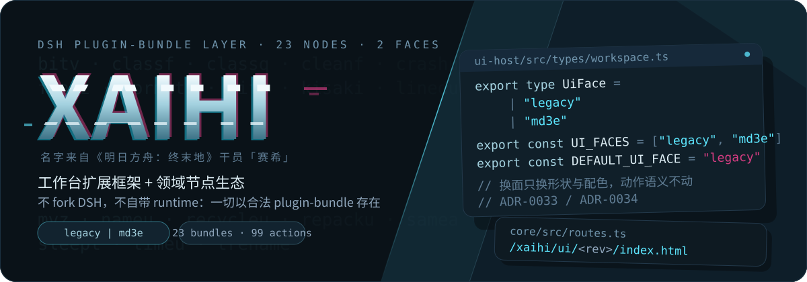
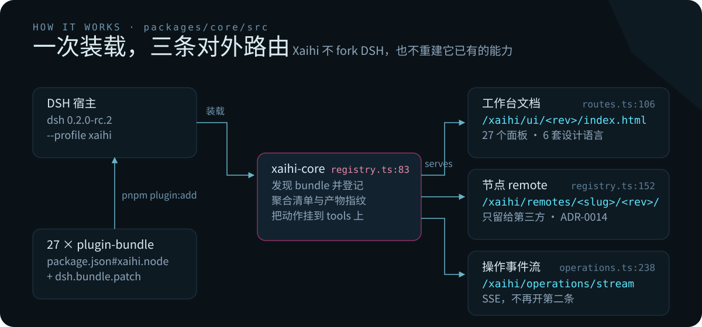
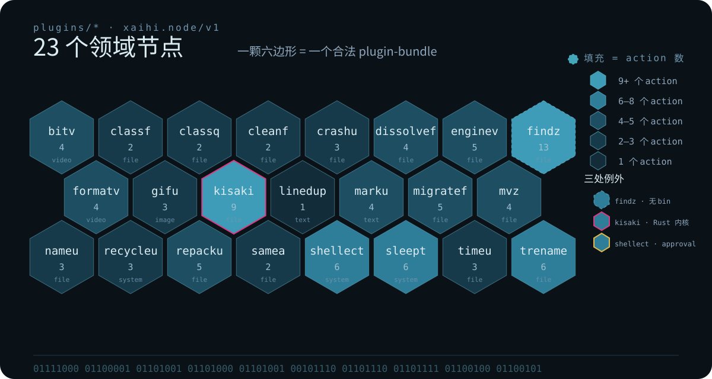
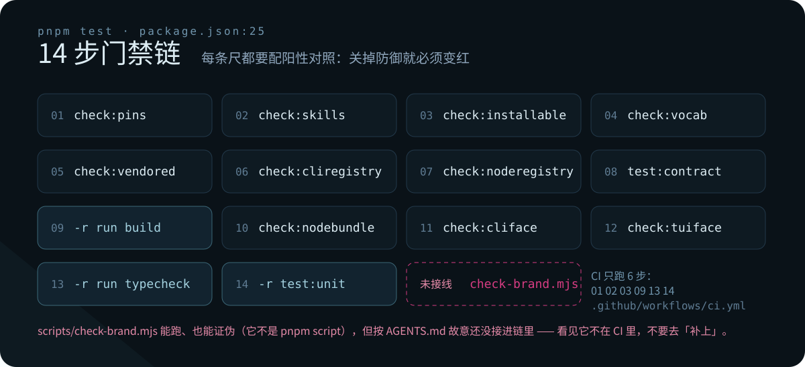

# Xaihi

**简体中文** · [English](README.md)

<p align="center">
  
</p>

<p align="center">
  <a href="./LICENSE"></a>
  
  
  
</p>

Xaihi 是给 **DeepSeek Harness（DSH）** 加的一层工作台：**27 个领域节点**，每个都带着自己的后端动作、
参数清单、危险语义、面板与终端面，全部以**合法的 DSH plugin-bundle** 形态存在。
不 fork DSH，不自带 runtime，也不重建它已经提供的能力。

## 现在到哪一步了

「做了」和「实机验过」分开写，三档：

- **实机验过** —— `pnpm plugin:add` 把节点包装进 profile，`pnpm profile:dump` rc=0，合并后的层配置
  1347 行、`# == @hibernalglow` 段 29 个（27 个节点包 + `xaihi-core` + `xaihi-ui`）。
  证据与原始输出：[`docs/stages/live-remotes-2026-10-07.md`](docs/stages/live-remotes-2026-10-07.md)。
- **只有编译 / 测试替身证据** —— 按 2026-10-07 的阶段报告，`ctx.subprocess` 的真兑现、`ask` 批准缝
  这一类断言当时都还是 test-double 或 compile-verified（[`plan-review-2026-10-07.md`](docs/stages/plan-review-2026-10-07.md) 第 6 条）。
- **构建不等于上屏** —— 2026-10-09 现读 `pnpm build:ui` rc=0（`main.js` 1.342 MiB + `main.css` 654 KiB，
  两条体积警告）。但「节点界面上屏」不由构建证明：那条判据是 `scripts/check-nodeface-live.mjs`，
  五条判据全部读自界面与对面，前置是一个在跑的开发宿主加一个开了调试端口的无窗口浏览器。
  它和 `check:cliface`、`check:tuiface` 一样属于现场取证，**故意还没接进 `pnpm test`**。

## 怎么运作

<p align="center">
  
</p>

四条机制，每条都有出处：

- **节点定义只有一份真源** —— `package.json#xaihi.node`，工具注册读它，清单与代码不许各说一套
  （`plugins/linedup/src/index.ts:2-4`）。契约是 `xaihi.node/v1`，清单是 `xaihi.manifest/1`。
- **插件即 bundle** —— 每个包自带 `dsh.bundle.patch`；profile 解析不了仓内 `workspace:*`，
  所以可安装的包必须自足（ADR-0002，由 `scripts/check-installable.mjs` 把守）。
- **配置只有一个出口** —— 声明是 `Schema.object({ … })` 里的 `.volatile()` 字段，值走 DSH 的 patch 层，
  读写走 `ctx.settings` / `ctx.remote.settings`。Xaihi 不自带配置文件（ADR-0013），密钥只能走 path op。
- **界面搬现成的** —— 动词是移植与接线，不是重新设计（ADR-0006）；一方节点走仓内 realm 注册表，
  MF2 remote 只留给第三方（ADR-0014）。

## 27 个节点

<p align="center">
  
</p>

六套设计语言 `native | md3 | mondrian | wuling | swiss | lonestar`
（`packages/ui-host/src/lib/design-theme/contract.ts:28`）里 **`md3` 只是其中一套，不是默认值**；
`native` 是显式的 no-op，保证「不开高级主题」有代码事实。图片取色（`image` seed）**尚未接线**，
所以故意不进类型 —— 类型里出现一个没人实现的枚举值，就是下一个假绿（同文件 `:63-67`）。

<details>
<summary>每个节点的测试文件数与终端面（实测，2026-10-09）</summary>

| 节点 | 测试文件 | CLI bin | 节点 | 测试文件 | CLI bin |
| --- | ---: | :---: | --- | ---: | :---: |
| `bandia` | 4 | ✓ | `linku` | 3 | ✓ |
| `bitv` | 4 | ✓ | `marku` | 3 | ✓ |
| `classf` | 4 | ✓ | `migratef` | 3 | ✓ |
| `classq` | 3 | ✓ | `mvz` | 4 | ✓ |
| `cleanf` | 3 | ✓ | `nameu` | 3 | ✓ |
| `crashu` | 3 | ✓ | `rawfilter` | 3 | ✓ |
| `dissolvef` | 2 | ✓ | `recycleu` | 3 | ✓ |
| `encodeb` | 3 | ✓ | `repacku` | 4 | ✓ |
| `enginev` | 3 | ✓ | `samea` | 2 | ✓ |
| `findz` | 6 | — | `sleept` | 5 | ✓ |
| `formatv` | 3 | ✓ | `smartzip` | 4 | ✓ |
| `gifu` | 4 | ✓ | `timeu` | 2 | ✓ |
| `kisaki` | 24 | ✓ | `trename` | 3 | ✓ |
| `linedup` | 2 | ✓ | 合计 | 110 | 26 / 27 |

三颗值得单独说：`findz` 的索引跑在**进程外 Go 核**里（`native/findz-go`），所以它没有 bin；
`kisaki` 用原生 czkawka Rust 内核做去重与磁盘分析，24 个测试文件是最深的一颗；
`classq` / `linku` / `sleept` 在清单里明确承诺了自己的终端命令。

</details>

## 门禁

<p align="center">
  
</p>

纪律只有一句：**每条尺必须配阳性对照**——「关掉防御就变红」的用例；没有正控的判据视为不存在，
期望值也不许通过再调一次被测函数得到。`scripts/check-brand.mjs`（品牌红线）能跑、也能证伪，
但**故意还没接进 `pnpm test` 与 CI**：那会把红线画在别人正在重写的搬运文件上（`AGENTS.md:82-84`）。

## 快速开始

```bash
pnpm install --frozen-lockfile

pnpm host              # DSH_HOME 与端口已经烧进脚本
pnpm plugin:add <plugins/xxx 的绝对路径>
pnpm profile:dump | head -40
```

所有 `dsh` 调用都走这些脚本，**不要手敲裸 `dsh`**：开发宿主与日常宿主必须是不同的 `DSH_HOME`，
测试对话不许出现在使用者正常的界面里。注意 profile **不隔离会话**——DSH 的会话按 cwd 落在
`$DSH_HOME/sessions/<cwd-slug>/`。

只跑一个包的单测（本仓经常有另一条 lane 同时在写，全仓 `pnpm test` 的结果不可归因）：

```bash
pnpm --filter @hibernalglow/xaihi-kisaki test:unit
```

## 终端面与桌面壳

- 26 个节点各自带一个 bin（`lib/cli.js`），`findz` 是唯一没有的。
- 聚合 CLI 与 `xlogs` 所在的 `packages/cli`、`packages/logging` 不在 workspace 表内
  （`pnpm-workspace.yaml:19-21`），所以聚合面起不来。
- 终端交互腿**今天现读**（`node scripts/check-tui-face.mjs`，rc=0，2026-10-09）：27 个包里 1 个还没有
  终端面（`findz` 没 bin），52 条腿判决为 **works 48 / 诚实拒绝 4 / 空话拒绝 0 / 崩 0** —— 也就是绝大多数
  `ui` / `gd` 起得来并在非交互环境里干净退出，4 条响亮点名缺的缝。但**真走那份共享运行时探测
  （`probeTerminalRuntime`）的包是 0 个**：它目前只有聚合 CLI 一个引用者（`packages/cli/src/index.ts:125`），
  在节点包里零命中。
- 清单里的「命令承诺」是另一件事：26 个有终端面的包里只有 3 个承诺过任何一条 CLI 命令，
  23 个 danger 包这张尺**故意不碰**（`docs/stages/cli-command-promises-2026-10-07.md:184-191`）。
- 桌面壳住在 `desktop/`：`desktop/dsh` 是上游 submodule（锁在 `desktop/UPSTREAM_PIN`），
  我们的改动是 `desktop/patches/dsh/*.patch`，重放靠 `node desktop/sync-dsh.mjs`（ADR-0011）。
  只有自家壳支持的能力必须**探测 → 退化 → 退化状态在界面上读得回来**；官方桌面端与 `dsh web`
  下可以功能退化，不许崩、不许静默、更不许伪造。

## 还没接线的东西

写在这里，免得被当成已经能用：

- 平台可选依赖包 `@hibernalglow/xaihi-<node>-<platform>-<arch>` **目前一个都还没发**（`CONTEXT.md:65`）。
- `packages/ui-kit` 已作废（ADR-0006），它的 `package.json` 描述还挂着「Material 3 组件」——
  那是残留，不是路线。
- 版本闸门只认精确值：所有 `@deepseek-ai/dsh*` 必须等于 `0.2.0-rc.2`（`scripts/check-pins.mjs:15`）。
  npm 上若干包的 `latest` 停在 `0.0.1-rc.1`，裸 `pnpm add` 会把整个生态悄悄降到不存在的 API 世代。

## 文档

| 位置 | 装什么 |
| --- | --- |
| [`docs/adr/`](docs/adr) | 决策，19 篇（0001–0020，没有 0012） |
| [`docs/stages/`](docs/stages) | 阶段交付与取证，19 篇：改了什么 / 为什么 / 与 DSH API 的关系（带 `file:line`）/ 后续扩展 |
| [`CONTEXT.md`](CONTEXT.md) | 跨模块领域词：bundle、plugin、profile、node、manifest、remote、run |
| [`docs/upstream-proposals.md`](docs/upstream-proposals.md) | DSH 支持不了的地方 ⇒ 提提案，不绕过缺口自己长一条通路 |
| [`docs/roadmap.md`](docs/roadmap.md) | 路线图 |

## 主题与配色

仓库名与这套视觉都来自《明日方舟：终末地》的干员**赛希**（英文名 Xaihi）。
色值不是凭印象，是从官方立绘的直方图量出来再按角色分工（测量 → UI 转译）：

| 角色 | 值 | 出处 |
| --- | --- | --- |
| 背景 | `#0A1218` | 立绘暗部 `#030507` / `#15222E`，加深以保证对比 |
| 前景 | `#DCECF3` | 立绘的霜白，直方图实测 |
| 主色 | `#69B3C8` | 立绘里出现次数最多的青蓝（`#4C6C89` 同族） |
| 亮色 | `#5DE6FE` | 饱和簇实测；只用在路由与代码值上 |
| 弱化 | `#7095AD` | 立绘中间调 |
| 强调 | `#D63C82` | 立绘的玫红 glitch 块；只标危险与未接线 |

图形语言也取自那张立绘：斜切的冷色碎片面、悬浮的产物卡、二进制缎带（图里那串就是
`xaihi.node` 的真实字节码），玫红碎片只留给「危险」和「故意没接线」。
本仓**不含任何原作美术**，只借用配色与构图气质。

## 许可

MIT © HibernalGlow —— 见 [LICENSE](LICENSE)。
